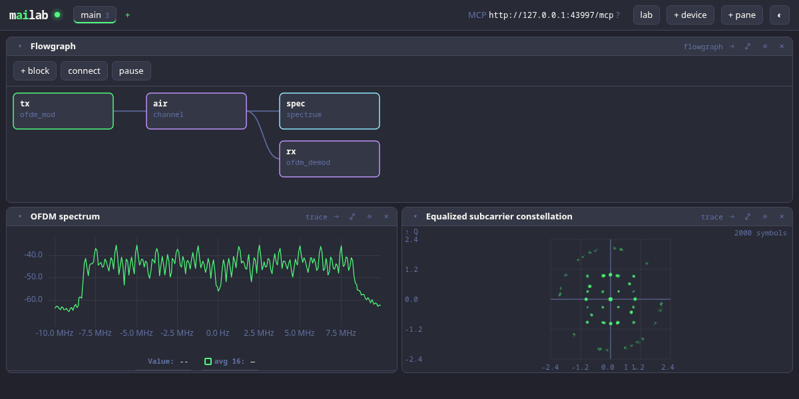

<!-- generated by bin/block-docs.js from the block catalog, about.md and example.json: edit those and run `yarn block-docs` -->

# `ofdm_mod`

**source** · Sources · [all blocks](../README.md)

> 802.11a/g-style OFDM transmitter (loopback signal source): 64-pt IFFT, 48 data + 4 pilot subcarriers, DC+guard nulls, 16-sample cyclic prefix, STF/LTF preamble, scrambled QAM per subcarrier. Modulates `input` bits (hex:/text:/bits:) and streams the packet continuously with a gap. scheme/mcs bpsk|qpsk|qam16|qam64|qam256. NOT real 802.11 (no conv-coding/interleaving/SIGNAL field) and NOT a transmitter - feed its output into `channel` -&gt; `ofdm_demod`.

An 802.11a/g-style OFDM *signal source*: `input` bits (hex:.. / text:.. / bits:..) are scrambled, mapped to
QAM per subcarrier (802.11 Gray mapping and K_MOD normalization; `scheme` bpsk|qpsk|qam16|qam64|qam256, or the
`mcs` alias), placed on 48 data + 4 pilot subcarriers (−26…26, DC and guards nulled, pilots on ±7/±21 with the
standard polarity sequence), 64-point IFFT, 16-sample cyclic prefix, and a short+long training preamble
(STF 160 + LTF 160 samples). The packet repeats with a `gap` of zeros at `rate`. Loop it through `channel` into
`ofdm_demod` to recover the bytes. Faithful in shape and demodulation, but *not* a bit-compatible 802.11 frame
(no convolutional code, interleaver or SIGNAL field) and **not a transmitter** — the TX path stays behind the
SDR safety gate.

## Parameters

| name | default | description |
|---|---|---|
| `input` | `"text:mAIlab OFDM "` | bits to modulate: hex:.. \| text:.. \| bits:.. |
| `scheme` | `"qpsk"` | bpsk\|qpsk\|qam16\|qam64\|qam256 (mcs alias accepted) |
| `mcs` | `""` | alias for scheme (bpsk\|qpsk\|qam16\|qam64\|qam256); overrides scheme if set |
| `cp_len` | `16` | cyclic prefix samples |
| `n_sym` | `0` | OFDM data symbols (0 = fit the input) |
| `rate` | `20000000` | sample rate (baseband; relative) |
| `gap` | `160` | zero samples between packets |
| `amp` | `1` | output amplitude |

## Inputs and outputs

- **Input:** none (source)
- **Output:** complex IQ OFDM waveform at `rate` (continuous packets with a `gap`)

## Example

A text message as 16-QAM OFDM through a 30 dB channel: the filled ~16 MHz block spectrum and the equalized subcarrier constellation recovered by ofdm_demod.



Ask the AI:

> Modulate a text message with the OFDM transmitter, send it through a 30 dB channel, and show the OFDM spectrum and the equalized constellation.

Graph ([example.json](example.json)):

```json
{
  "blocks": [
    {"id": "tx", "type": "ofdm_mod", "params": {"input": "text:hello OFDM ", "scheme": "qam16", "rate": 20000000}},
    {"id": "air", "type": "channel", "params": {"snr_db": 30}},
    {"id": "spec", "type": "spectrum", "params": {"fft": 256, "traces": ["avg"], "average": 16}},
    {"id": "rx", "type": "ofdm_demod", "params": {"scheme": "qam16"}}
  ],
  "links": [["tx", "air"], ["air", "spec"], ["air", "rx"]]
}
```

MCP calls:

```
device_add {"id": "fg", "driver": "flowgraph"}
device_command {"id": "fg", "command": "set_graph", "args": {"graph": <the graph above>}}
pane_add {"type": "flowgraph", "title": "Flowgraph", "config": {"device": "fg"}}
pane_add {"type": "trace", "title": "OFDM spectrum", "config": {"traces": ["fg_spec"]}}
pane_add {"type": "trace", "title": "Equalized subcarrier constellation", "config": {"traces": ["fg_rx_const"]}}
```

## Related

- [`ofdm_demod`](../ofdm_demod/README.md): 802.11a/g-style OFDM receiver: packet detect, CFO correct, LTF equalize, pilots, demap, descramble
- [`channel`](../channel/README.md): AWGN, carrier offset, phase and gain between TX and RX
- [`spectrum`](../spectrum/README.md): spectrum analyzer trace: RBW, window, max/min hold, averaging
- [`mod`](../mod/README.md): bits to IQ: PSK, QAM, APSK, OOK, FSK, MSK, GFSK, GMSK...
