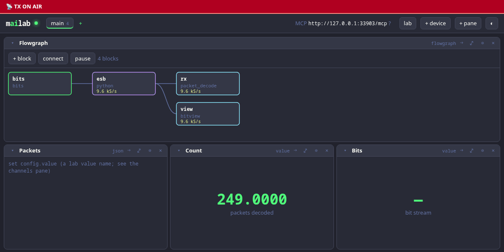

<!-- generated by bin/block-docs.js from the block catalog, about.md and example.json: edit those and run `yarn block-docs` -->

# `packet_decode`

**sink** · Digital: bits, framing, BER, UART, protocol decode · [all blocks](../README.md)

> decode BLE advertising or nRF Enhanced ShockBurst packets out of a raw bit stream: value &lt;device&gt;_&lt;id&gt; with the last decoded packets + CRC status, count channel

Packet decoder for the two most common 2.4 GHz "protocols of opportunity". Feed it on-air bits in receive
order (first bit first, each byte LSB first — exactly what `slicer` / `uart_rx`-style chains produce at one
sample per bit):

- `protocol` `ble`: finds the advertising access address `0x8E89BED6`, dewhitens the PDU with the
  `channel` LFSR, and checks the CRC-24. Reports PDU type, length, advertiser address (`addr`) and payload.
- `protocol` `esb`: syncs on the pipe `address` (hex, 3-5 bytes), reads the 9-bit PCF (length / PID / no-ack)
  and checks the nRF CRC-8.

`max_errors` tolerates bit errors in the sync word. Every decoded packet lands in `value <device>_<id>`
(newest `keep` packets, each with a `crc_ok` flag), and a total count is published on channel
`<device>_<id>_count`. Pair it with `baud_est` + `clock_recovery` to pull packets off a raw IQ recording,
or watch an nRF sniffer live.

## Parameters

| name | default | description |
|---|---|---|
| `protocol` | `"ble"` | ble (BLE advertising channels) or esb (nRF Enhanced ShockBurst) |
| `channel` | `37` | BLE channel index, used for dewhitening |
| `address` | `"e7e7e7e7e7"` | ESB pipe address (hex, 3-5 bytes) |
| `max_errors` | `0` | allowed bit errors in the access address / sync word |
| `keep` | `20` | packets kept in the value |

## Inputs and outputs

- **Input:** bits (0/1) in on-air order (first bit first, each byte LSB first)
- **Output:** value &lt;device&gt;_&lt;id&gt; (decoded packets, CRC-checked), channel &lt;device&gt;_&lt;id&gt;_count

## Example

A synthesizer python block emits a repeating nRF Enhanced ShockBurst frame (address e7e7e7e7e7, 8-byte payload); packet_decode syncs on the address, reads the PCF and verifies the CRC-8. The decoded packets (payload, PID, CRC status) and the packet count are shown live.



Ask the AI:

> Decode Enhanced ShockBurst packets from a bit stream.

Graph ([example.json](example.json)):

```json
{
  "blocks": [
    {"id": "bits", "type": "bits", "params": {"pattern": "prbs9", "bitrate": 9600}},
    {"id": "esb", "type": "python", "params": {"code": "def work(x, rate):\n    addr = bytes.fromhex('e7e7e7e7e7')\n    payload = bytes(range(1, 9))\n    pcf = len(payload) | (1 << 6)\n    body = np.concatenate([modem.unpack_bits_lsb(addr),\n                           np.array([(pcf >> i) & 1 for i in range(9)], dtype=np.uint8),\n                           modem.unpack_bits_lsb(payload)])\n    crc = modem.esb_crc8(addr + bytes([pcf & 0xFF, (pcf >> 8) & 0xFF]) + payload)\n    frame = np.concatenate([body, modem.unpack_bits_lsb(bytes([crc]))])\n    n = len(x)\n    return np.tile(frame, n // len(frame) + 1)[:n].astype(float), rate"}},
    {"id": "rx", "type": "packet_decode", "params": {"protocol": "esb", "address": "e7e7e7e7e7"}},
    {"id": "view", "type": "bitview", "params": {"bits": 128, "fps": 2}}
  ],
  "links": [["bits", "esb"], ["esb", "rx"], ["esb", "view"]]
}
```

MCP calls:

```
device_add {"id": "fg", "driver": "flowgraph"}
device_command {"id": "fg", "command": "set_graph", "args": {"graph": <the graph above>}}
pane_add {"type": "flowgraph", "title": "Flowgraph", "config": {"device": "fg"}}
pane_add {"type": "json", "title": "Packets", "config": {"channel": "fg_rx"}}
pane_add {"type": "value", "title": "Count", "config": {"channel": "fg_rx_count", "label": "packets decoded"}}
pane_add {"type": "value", "title": "Bits", "config": {"channel": "fg_view", "label": "bit stream"}}
```

## Related

- [`slicer`](../slicer/README.md): symbols to bits (linear schemes or 2/4-level real), with EVM
- [`clock_recovery`](../clock_recovery/README.md): Gardner timing recovery for FSK / OOK / real symbols
- [`bits`](../bits/README.md): PRBS or pattern bit source, optionally framed
- [`decode`](../decode/README.md): sigrok / builtin protocol decoder on logic samples (UART, SPI, I2C...)
