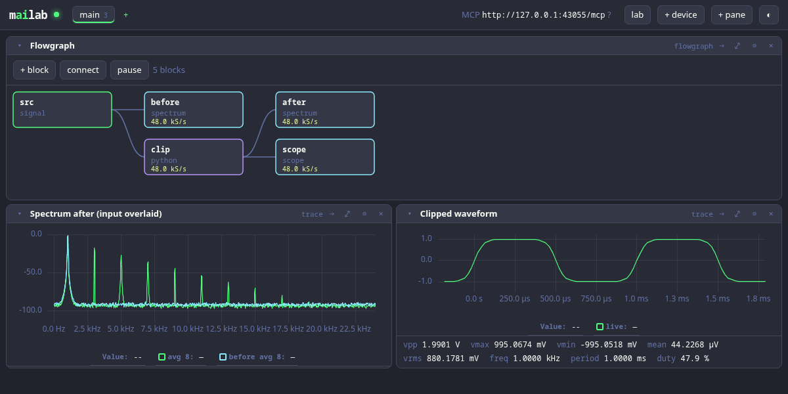

<!-- generated by bin/block-docs.js from the block catalog, about.md and example.json: edit those and run `yarn block-docs` -->

# `python`

**dsp** · Scripting · [all blocks](../README.md)

> scriptable block: params.code defines work(x, rate) -&gt; y or (y, rate); np, dsp, modem, lab (sample/log/event/value/blob) and state are in scope

Your own DSP in a block: `params.code` defines `work(x, rate)` returning `y` (same rate), `(y, new_rate)` or
None (nothing downstream). numpy (`np`), liquid-dsp (`dsp`), the modem helpers (`modem`), the lab (`lab.sample`,
`lab.log`, `lab.event`, `lab.value`, `lab.blob`) and a persistent `state` dict are in scope. Prototype a block, add a
custom measurement or adapt formats between blocks; promote it to a real block class in python/ once it works.

## Parameters

| name | default | description |
|---|---|---|
| `code` | `"def work(x, rate):\n    return x * 2"` | python source |

## Inputs and outputs

- **Input:** anything
- **Output:** whatever work() returns (default: same rate)

## Example

A soft clipper (`tanh`) as a python block: the harmonics it creates on a 1 kHz tone (spectrum after, input overlaid), and the clipped waveform.



Ask the AI:

> Add a python block that soft-clips the signal with tanh and show me the harmonics it adds.

Graph ([example.json](example.json)):

```json
{
  "blocks": [
    {"id": "src", "type": "signal", "params": {"rate": 48000, "freq": 1000, "amp": 1, "noise": 0.001}},
    {"id": "before", "type": "spectrum", "params": {"fft": 2048, "traces": ["avg"], "onesided": "true"}},
    {"id": "clip", "type": "python", "params": {"code": "def work(x, rate):\n    return np.tanh(3 * np.real(x)).astype(np.float32)"}},
    {"id": "after", "type": "spectrum", "params": {"fft": 2048, "traces": ["avg"], "overlay": ["before"]}},
    {"id": "scope", "type": "scope", "params": {"samples": 96, "measure": ["vpp"]}}
  ],
  "links": [["src", "before"], ["src", "clip"], ["clip", "after"], ["clip", "scope"]]
}
```

MCP calls:

```
device_add {"id": "fg", "driver": "flowgraph"}
device_command {"id": "fg", "command": "set_graph", "args": {"graph": <the graph above>}}
pane_add {"type": "flowgraph", "title": "Flowgraph", "config": {"device": "fg"}}
pane_add {"type": "trace", "title": "Spectrum after (input overlaid)", "config": {"traces": ["fg_after"]}}
pane_add {"type": "trace", "title": "Clipped waveform", "config": {"traces": ["fg_scope"]}}
```

## Related

- [`measure`](../measure/README.md): one statistic of the stream as a channel
- [`spectrum`](../spectrum/README.md): spectrum analyzer trace: RBW, window, max/min hold, averaging
- [`decode`](../decode/README.md): sigrok / builtin protocol decoder on logic samples (UART, SPI, I2C...)
