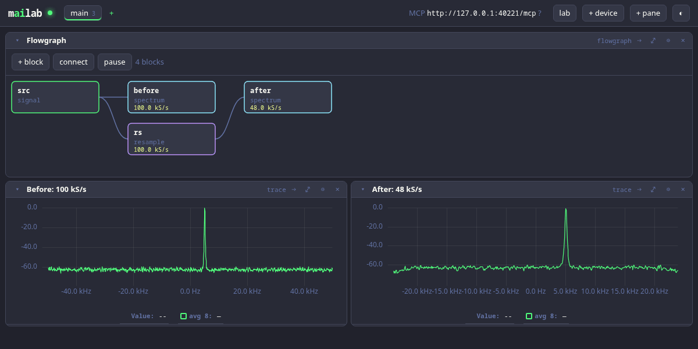

<!-- generated by bin/block-docs.js from the block catalog, about.md and example.json: edit those and run `yarn block-docs` -->

# `resample`

**dsp** · Filters and DSP · [all blocks](../README.md)

> arbitrary-rate resampler

Arbitrary-ratio resampler (liquid msresamp, anti-aliased) to an output `rate`. Use it to bring a channel down to
a rate the next block likes (48 kHz audio, a multiple of the symbol rate), or to match the rate of an audio sink or
WAV file. Unlike `decimate`, any ratio works and filtering is built in. Typical chain:
`soapy -> shift -> lowpass -> resample (48 kHz) -> fm_demod -> audio`.

## Parameters

| name | default | description |
|---|---|---|
| `rate` | `48000` | output sample rate |

## Inputs and outputs

- **Input:** complex IQ or real
- **Output:** same kind at `rate`

## Example

A 5 kHz tone at 100 kS/s resampled to 48 kS/s: spectrum before (100 kHz wide) and after (48 kHz wide).



Ask the AI:

> Resample the 100 kS/s signal to 48 kS/s and show both spectra.

Graph ([example.json](example.json)):

```json
{
  "blocks": [
    {"id": "src", "type": "signal", "params": {"rate": 100000, "freq": 5000, "noise": 0.02}},
    {"id": "before", "type": "spectrum", "params": {"fft": 1024, "traces": ["avg"]}},
    {"id": "rs", "type": "resample", "params": {"rate": 48000}},
    {"id": "after", "type": "spectrum", "params": {"fft": 512, "traces": ["avg"]}}
  ],
  "links": [["src", "before"], ["src", "rs"], ["rs", "after"]]
}
```

MCP calls:

```
device_add {"id": "fg", "driver": "flowgraph"}
device_command {"id": "fg", "command": "set_graph", "args": {"graph": <the graph above>}}
pane_add {"type": "flowgraph", "title": "Flowgraph", "config": {"device": "fg"}}
pane_add {"type": "trace", "title": "Before: 100 kS/s", "config": {"traces": ["fg_before"]}}
pane_add {"type": "trace", "title": "After: 48 kS/s", "config": {"traces": ["fg_after"]}}
```

## Related

- [`decimate`](../decimate/README.md): keeps every n-th sample (no filtering)
- [`lowpass`](../lowpass/README.md): Kaiser FIR low-pass / channel filter
- [`fm_demod`](../fm_demod/README.md): FM demodulator to audio
- [`audio`](../audio/README.md): plays audio in the browser (lab audio stream)
