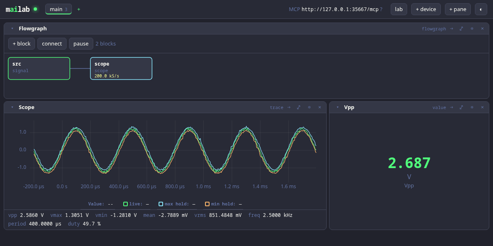

<!-- generated by bin/block-docs.js from the block catalog, about.md and example.json: edit those and run `yarn block-docs` -->

# `scope`

**sink** · Sinks and views · [all blocks](../README.md)

> oscilloscope -&gt; trace &lt;device&gt;_&lt;id&gt;: trigger (rising/falling, level, auto/normal, pretrigger), traces live/max/min/avg, measurements (vpp vmax vmin mean vrms freq period duty) -&gt; channels &lt;device&gt;_&lt;id&gt;_&lt;m&gt;

Oscilloscope: captures of `samples` samples on a rising or falling edge through `level` (with `pretrigger`
fraction before it), in auto mode (free-run when nothing triggers) or normal mode (hold the last trigger). Traces live,
max/min hold and average; measurements (Vpp, max, min, mean, RMS, frequency, period, duty) are shown in the pane and
the ones in `measure` become channels you can chart or put rules on. Complex input: pick `part` real, imag or mag.

## Parameters

| name | default | description |
|---|---|---|
| `samples` | `1000` | samples per capture |
| `part` | `"real"` | real\|imag\|mag for complex input |
| `trigger` | `"rising"` | rising\|falling\|none |
| `level` | `0` | trigger level |
| `mode` | `"auto"` | auto (free-run without trigger) \| normal (hold last trigger) |
| `pretrigger` | `0.1` | fraction of the capture before the trigger |
| `traces` | `["live"]` | any of live, max, min, avg |
| `average` | `8` | captures in the avg trace |
| `measure` | `["vpp","freq"]` | measurements to publish as channels |
| `fps` | `10` | captures per second |

## Inputs and outputs

- **Input:** real, or complex (`part` picks real/imag/mag)
- **Output:** trace &lt;device&gt;_&lt;id&gt; (s vs V, with measurements), channels &lt;device&gt;_&lt;id&gt;_&lt;measurement&gt;

## Example

A noisy 2.5 kHz tone, rising-edge triggered: live, max and min hold, with measurements; Vpp as a readout.



Ask the AI:

> Put the signal on a scope triggered on the rising edge, with max/min hold, and show me Vpp and frequency.

Graph ([example.json](example.json)):

```json
{
  "blocks": [
    {"id": "src", "type": "signal", "params": {"rate": 200000, "freq": 2500, "amp": 1.2, "noise": 0.06}},
    {"id": "scope", "type": "scope", "params": {"samples": 400, "trigger": "rising", "level": 0, "traces": ["live", "max", "min"], "measure": ["vpp", "freq"]}}
  ],
  "links": [["src", "scope"]]
}
```

MCP calls:

```
device_add {"id": "fg", "driver": "flowgraph"}
device_command {"id": "fg", "command": "set_graph", "args": {"graph": <the graph above>}}
pane_add {"type": "flowgraph", "title": "Flowgraph", "config": {"device": "fg"}}
pane_add {"type": "trace", "title": "Scope", "config": {"traces": ["fg_scope"]}}
pane_add {"type": "value", "title": "Vpp", "config": {"channel": "fg_scope_vpp", "precision": 3, "label": "Vpp"}}
```

## Related

- [`spectrum`](../spectrum/README.md): spectrum analyzer trace: RBW, window, max/min hold, averaging
- [`measure`](../measure/README.md): one statistic of the stream as a channel
- [`eye`](../eye/README.md): eye diagram
- [`mag`](../mag/README.md): magnitude |x|: envelope detector
