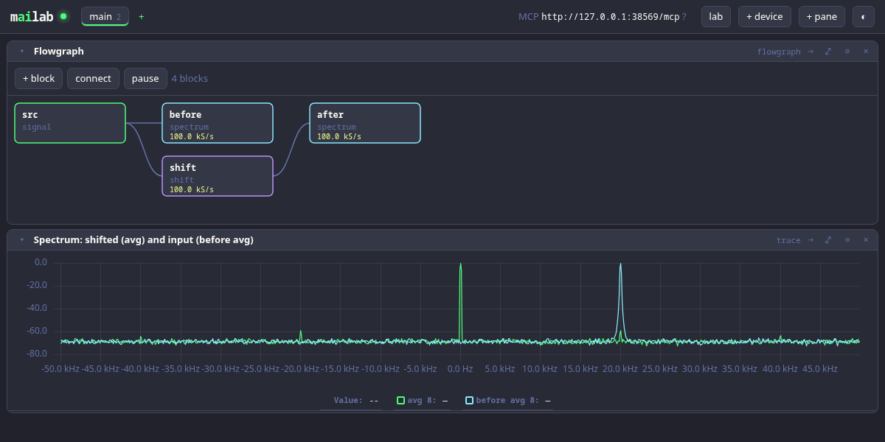

<!-- generated by bin/block-docs.js from the block catalog, about.md and example.json: edit those and run `yarn block-docs` -->

# `shift`

**dsp** · Filters and DSP · [all blocks](../README.md)

> move a signal at +offset Hz to baseband

Frequency shift (complex mixer, liquid NCO): moves a signal sitting at `+offset` Hz down to 0 Hz. It is the first
step of tuning to one channel inside a wider capture: `shift` the channel to baseband, `lowpass` to its bandwidth,
`resample` (or `decimate`) to a sensible rate, then demodulate. A negative offset moves a signal from below center.

## Parameters

| name | default | description |
|---|---|---|
| `offset` | `0` | Hz |

## Inputs and outputs

- **Input:** complex IQ
- **Output:** complex IQ, same rate

## Example

A 20 kHz tone shifted to 0 Hz: the spectrum after the shift, with the input overlaid.



Ask the AI:

> Shift the 20 kHz tone down to baseband and show the spectrum before and after.

Graph ([example.json](example.json)):

```json
{
  "blocks": [
    {"id": "src", "type": "signal", "params": {"rate": 100000, "freq": 20000, "noise": 0.01}},
    {"id": "before", "type": "spectrum", "params": {"fft": 1024, "traces": ["avg"]}},
    {"id": "shift", "type": "shift", "params": {"offset": 20000}},
    {"id": "after", "type": "spectrum", "params": {"fft": 1024, "traces": ["avg"], "overlay": ["before"]}}
  ],
  "links": [["src", "before"], ["src", "shift"], ["shift", "after"]]
}
```

MCP calls:

```
device_add {"id": "fg", "driver": "flowgraph"}
device_command {"id": "fg", "command": "set_graph", "args": {"graph": <the graph above>}}
pane_add {"type": "flowgraph", "title": "Flowgraph", "config": {"device": "fg"}}
pane_add {"type": "trace", "title": "Spectrum: shifted (avg) and input (before avg)", "config": {"traces": ["fg_after"]}}
```

## Related

- [`lowpass`](../lowpass/README.md): Kaiser FIR low-pass / channel filter
- [`resample`](../resample/README.md): any-ratio, anti-aliased resampler to a new rate
- [`spectrum`](../spectrum/README.md): spectrum analyzer trace: RBW, window, max/min hold, averaging
- [`file`](../file/README.md): plays a raw cf32 IQ recording in real time
