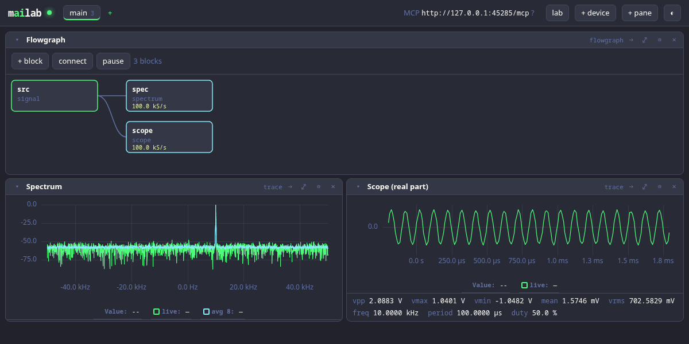

<!-- generated by bin/block-docs.js from the block catalog, about.md and example.json: edit those and run `yarn block-docs` -->

# `signal`

**source** · Sources · [all blocks](../README.md)

> complex tone plus noise

The simplest source: a complex exponential at `freq` plus complex white noise, generated in real time at `rate`.
Use it to test a chain before real hardware is connected: filter responses (spectrum before/after), mixers and
resamplers, AGC, scope triggers and measurements. Because it is complex, a positive `freq` shows up on the right of a
spectrum and a negative one on the left; blocks that want real audio (audio sinks, audio processing, `analog_mod`) use
its real part, a cosine. Typical chains: `signal -> spectrum`, `signal -> lowpass -> spectrum`, `signal -> analog_mod -> fm_demod -> scope`.

## Parameters

| name | default | description |
|---|---|---|
| `rate` | `100000` | sample rate |
| `freq` | `10000` | tone Hz |
| `amp` | `1` | tone amplitude (1.0 = 0 dBFS) |
| `noise` | `0.01` | noise rms |

## Inputs and outputs

- **Input:** none (source)
- **Output:** complex IQ at `rate`

## Example

A 10 kHz tone with some noise at 100 kS/s: its spectrum and the triggered real part on a scope.



Ask the AI:

> Make a 10 kHz test tone with a bit of noise and show me the spectrum and a scope view.

Graph ([example.json](example.json)):

```json
{
  "blocks": [
    {"id": "src", "type": "signal", "params": {"rate": 100000, "freq": 10000, "amp": 1, "noise": 0.05}},
    {"id": "spec", "type": "spectrum", "params": {"fft": 2048, "traces": ["live", "avg"]}},
    {"id": "scope", "type": "scope", "params": {"samples": 200, "trigger": "rising", "level": 0, "measure": ["vpp", "freq"]}}
  ],
  "links": [["src", "spec"], ["src", "scope"]]
}
```

MCP calls:

```
device_add {"id": "fg", "driver": "flowgraph"}
device_command {"id": "fg", "command": "set_graph", "args": {"graph": <the graph above>}}
pane_add {"type": "flowgraph", "title": "Flowgraph", "config": {"device": "fg"}}
pane_add {"type": "trace", "title": "Spectrum", "config": {"traces": ["fg_spec"]}}
pane_add {"type": "trace", "title": "Scope (real part)", "config": {"traces": ["fg_scope"]}}
```

## Related

- [`modulated`](../modulated/README.md): ready-made RRC-shaped digital test signal (PSK/QAM/APSK) with noise and offsets
- [`spectrum`](../spectrum/README.md): spectrum analyzer trace: RBW, window, max/min hold, averaging
- [`scope`](../scope/README.md): triggered oscilloscope with measurements
- [`channel`](../channel/README.md): AWGN, carrier offset, phase and gain between TX and RX
