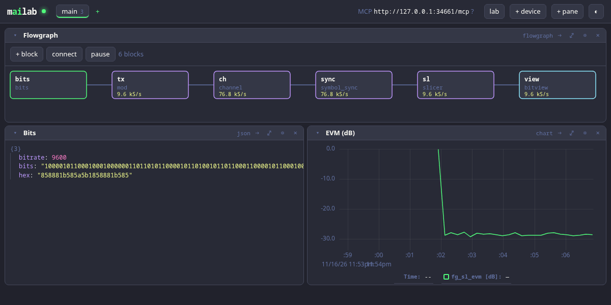

<!-- generated by bin/block-docs.js from the block catalog, about.md and example.json: edit those and run `yarn block-docs` -->

# `slicer`

**dsp** · Modulation, demodulation and sync · [all blocks](../README.md)

> symbols -&gt; bits. Complex input: liquid demod of `scheme` (+ EVM -&gt; channel &lt;device&gt;_&lt;id&gt;_evm). Real input: `levels` 2 (adaptive threshold) or 4 (4fsk gray)

Turns symbols into bits. Complex input is demodulated against the linear `scheme` (and the EVM is published as a
channel); real input is sliced with an adaptive threshold (`levels` 2) or as Gray-coded 4-FSK (`levels` 4). It sits at
the end of every digital receive chain (`symbol_sync` or `clock_recovery` before it) and feeds `ber`, `framer`,
`bitview` or `uart_rx`.

## Parameters

| name | default | description |
|---|---|---|
| `scheme` | `"qpsk"` | linear scheme for complex input |
| `levels` | `2` | 2\|4 for real input |
| `fps` | `5` | EVM updates/s |

## Inputs and outputs

- **Input:** complex symbols (linear schemes) or real symbols (FSK)
- **Output:** bits (0/1); channel &lt;device&gt;_&lt;id&gt;_evm for complex input

## Example

The text "mailab" sent as BPSK and received: the sliced bits in a bit view, and the slicer's EVM.



Ask the AI:

> Slice the received BPSK symbols to bits and show me the bits and the EVM.

Graph ([example.json](example.json)):

```json
{
  "blocks": [
    {"id": "bits", "type": "bits", "params": {"pattern": "text:mailab ", "bitrate": 9600}},
    {"id": "tx", "type": "mod", "params": {"scheme": "bpsk", "sps": 8}},
    {"id": "ch", "type": "channel", "params": {"snr_db": 20}},
    {"id": "sync", "type": "symbol_sync", "params": {"sps": 8}},
    {"id": "sl", "type": "slicer", "params": {"scheme": "bpsk"}},
    {"id": "view", "type": "bitview", "params": {"bits": 96}}
  ],
  "links": [["bits", "tx"], ["tx", "ch"], ["ch", "sync"], ["sync", "sl"], ["sl", "view"]]
}
```

MCP calls:

```
device_add {"id": "fg", "driver": "flowgraph"}
device_command {"id": "fg", "command": "set_graph", "args": {"graph": <the graph above>}}
pane_add {"type": "flowgraph", "title": "Flowgraph", "config": {"device": "fg"}}
pane_add {"type": "json", "title": "Bits", "config": {"value": "fg_view"}}
pane_add {"type": "chart", "title": "EVM (dB)", "config": {"channels": ["fg_sl_evm"], "seconds": 8}}
```

## Related

- [`symbol_sync`](../symbol_sync/README.md): symbol timing recovery, one sample per symbol out
- [`clock_recovery`](../clock_recovery/README.md): Gardner timing recovery for FSK / OOK / real symbols
- [`ber`](../ber/README.md): bit error rate against a PRBS, self-synchronizing
- [`framer`](../framer/README.md): finds a sync word and cuts frames from bits
- [`bitview`](../bitview/README.md): shows the last bits of a stream as binary and hex
