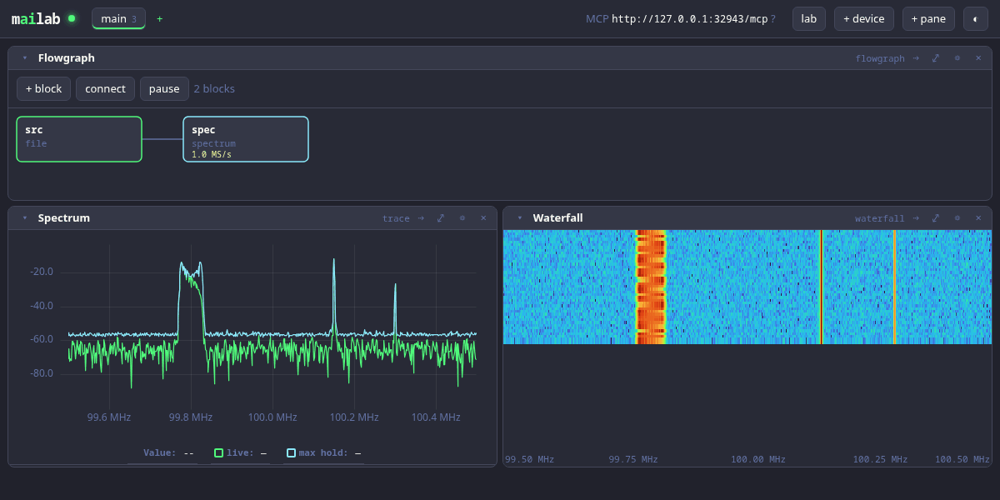

<!-- generated by bin/block-docs.js from the block catalog, about.md and example.json: edit those and run `yarn block-docs` -->

# `soapy`

**source** · Sources · [all blocks](../README.md)

> SoapySDR receiver (bladeRF, HackRF, RTL-SDR...)

Receives complex baseband from any SoapySDR device (RTL-SDR, HackRF, bladeRF, Airspy, LimeSDR, PlutoSDR... as
long as its Soapy module is installed) at center `freq`, sample `rate` and `gain`. `args` selects the device the way
`SoapySDRUtil --find` prints it, e.g. `driver=rtlsdr` or `driver=bladerf,serial=...`. Use it as the front of every
live-radio chain: spectrum and waterfall to find a signal, then `shift`/`lowpass`/`resample` to a channel and a
demodulator. The `sdr_fm_audio` and `sdr_am_audio` templates build complete voice receivers around it. Set the
spectrum's `center` to `freq` so the x axis shows RF frequencies.

## Parameters

| name | default | description |
|---|---|---|
| `args` | `""` | e.g. driver=bladerf |
| `freq` | `100000000` | center frequency Hz |
| `rate` | `2000000` | sample rate |
| `gain` | `30` | RX gain dB (overall, driver distributes it) |

## Inputs and outputs

- **Input:** none (source)
- **Output:** complex IQ at `rate` (baseband around `freq`)

## Example

An RTL-SDR at 100 MHz, 1 MS/s: spectrum with RF frequencies on the x axis and a waterfall.

**Needs:** a SoapySDR device and its Soapy module (python SoapySDR bindings).



> **Screenshot uses a substitute:** no SDR is attached to the docs machine, so `src` is a `file` block playing a generated 1 MS/s IQ file (FM carrier at -200 kHz, CW tones at +150 and +300 kHz).

`$MEDIA` is your media directory (`DATA_DIR/media` or one of `MAILAB_MEDIA_DIRS`); the screenshot and tests use generated files (`demo.cf32`: see `makeMedia` in `src/utils/block-docs`).

Ask the AI:

> Tune the RTL-SDR to 100 MHz and show me the spectrum and waterfall.

Graph ([example.json](example.json)):

```json
{
  "blocks": [
    {"id": "src", "type": "soapy", "params": {"args": "driver=rtlsdr", "freq": 100000000, "rate": 1000000, "gain": 30}},
    {"id": "spec", "type": "spectrum", "params": {"rbw": 2000, "traces": ["live", "max"], "points": 600, "center": 100000000}}
  ],
  "links": [["src", "spec"]]
}
```

MCP calls:

```
device_add {"id": "fg", "driver": "flowgraph"}
device_command {"id": "fg", "command": "set_graph", "args": {"graph": <the graph above>}}
# a ready-made template that uses this block (replaces the graph):
device_command {"id": "fg", "command": "load_template", "args": {"name": "sdr_fm_audio", "args": "driver=rtlsdr", "freq": 145500000, "rate": 1000000}}
pane_add {"type": "flowgraph", "title": "Flowgraph", "config": {"device": "fg"}}
pane_add {"type": "trace", "title": "Spectrum", "config": {"traces": ["fg_spec"]}}
pane_add {"type": "waterfall", "title": "Waterfall", "config": {"trace": "fg_spec", "rows": 80}}
```

## Related

- [`spectrum`](../spectrum/README.md): spectrum analyzer trace: RBW, window, max/min hold, averaging
- [`file`](../file/README.md): plays a raw cf32 IQ recording in real time
- [`net_source`](../net_source/README.md): IQ or logic samples in over TCP / UDP
- [`fm_demod`](../fm_demod/README.md): FM demodulator to audio
