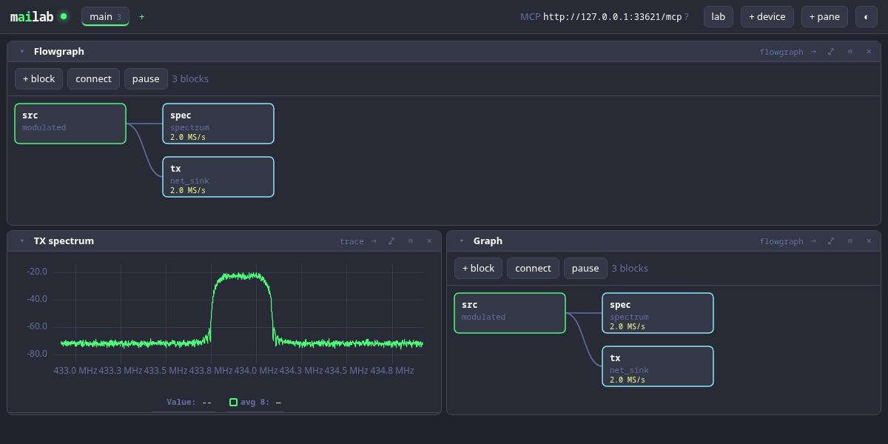

<!-- generated by bin/block-docs.js from the block catalog, about.md and example.json: edit those and run `yarn block-docs` -->

# `soapy_sink`

**sink** · Sources · [all blocks](../README.md)

> SoapySDR transmitter (bladeRF, HackRF, ...). Gated twice: the lab refuses to start a graph with a soapy_sink outside the TX policy (band allow-list, gain/time caps, approval, auto-stop), and the bridge re-checks the band here unless --chamber was passed

Transmits complex baseband to any SoapySDR device with a TX path (bladeRF, HackRF, LimeSDR, PlutoSDR...) at center
`freq`, sample `rate` and `gain`. `args` selects the device the way `SoapySDRUtil --find` prints it,
e.g. `driver=bladerf` or `driver=hackrf`.

**This block is gated.** The lab refuses to start a graph containing a `soapy_sink` outside the shared TX policy
(`src/txpolicy`): the frequency must sit inside the `MAILAB_RF_REGION` bands plus any `MAILAB_RF_TX_EXTRA`
person-configured ranges, TX gain is capped by `MAILAB_RF_TX_MAX_GAIN`, the run asks for approval like any other
transmission, and the lab opens a TX session that auto-stops after `MAILAB_RF_TX_MAX_SECONDS` and can be killed
from the UI banner, `POST /api/tx/kill`, or the MCP `tx_kill` tool. Under `MAILAB_RF_CHAMBER` / `MAILAB_UNSAFE`
the band check is skipped. The bridge re-checks the band a second time on load unless `--chamber` was passed.

Feed it like any sink: a `modulated` source for a test carrier, or a full modem chain (`mod` → `channel` → pulse
shape → `soapy_sink`). Watch the transmitted spectrum with a second (receive) device or an `rtl_power` scan.

## Parameters

| name | default | description |
|---|---|---|
| `args` | `""` | e.g. driver=bladerf |
| `freq` | `100000000` | center frequency Hz |
| `rate` | `2000000` | sample rate |
| `gain` | `30` | TX gain dB (overall, driver distributes it) |

## Inputs and outputs

- **Input:** complex IQ at `rate` (baseband around `freq`)
- **Output:** none

## Example

A QPSK test carrier transmitted at 433.92 MHz through a SoapySDR TX device, 2 MS/s at gain 30: the TX spectrum.

**Needs:** a SoapySDR device with a TX path and its module (python SoapySDR bindings), plus lab TX policy approval (the freq must be inside the region bands or MAILAB_RF_TX_EXTRA).



> **Screenshot uses a substitute:** no TX-capable SDR is attached to the docs machine, so `tx` is a `net_sink` blasting the same IQ to 127.0.0.1:$PORT (UDP, cf32) - watch it with `nc -u -l` or another graph's net_source.

Ask the AI:

> Transmit this QPSK signal at 433.92 MHz through the bladeRF.

Graph ([example.json](example.json)):

```json
{
  "blocks": [
    {"id": "src", "type": "modulated", "params": {"scheme": "qpsk", "rate": 2000000, "sps": 8, "snr_db": 40}},
    {"id": "spec", "type": "spectrum", "params": {"fft": 2048, "traces": ["avg"], "center": 433920000}},
    {"id": "tx", "type": "soapy_sink", "params": {"args": "driver=bladerf", "freq": 433920000, "rate": 2000000, "gain": 30}}
  ],
  "links": [["src", "spec"], ["src", "tx"]]
}
```

MCP calls:

```
device_add {"id": "fg", "driver": "flowgraph"}
device_command {"id": "fg", "command": "set_graph", "args": {"graph": <the graph above>}}
pane_add {"type": "flowgraph", "title": "Flowgraph", "config": {"device": "fg"}}
pane_add {"type": "trace", "title": "TX spectrum", "config": {"traces": ["fg_spec"]}}
pane_add {"type": "flowgraph", "title": "Graph", "config": {"device": "fg"}}
```

## Related

- [`soapy`](../soapy/README.md): live IQ from a SoapySDR receiver (RTL-SDR, HackRF, bladeRF...)
- [`net_sink`](../net_sink/README.md): IQ or logic samples out over TCP / UDP
- [`modulated`](../modulated/README.md): ready-made RRC-shaped digital test signal (PSK/QAM/APSK) with noise and offsets
- [`spectrum`](../spectrum/README.md): spectrum analyzer trace: RBW, window, max/min hold, averaging
