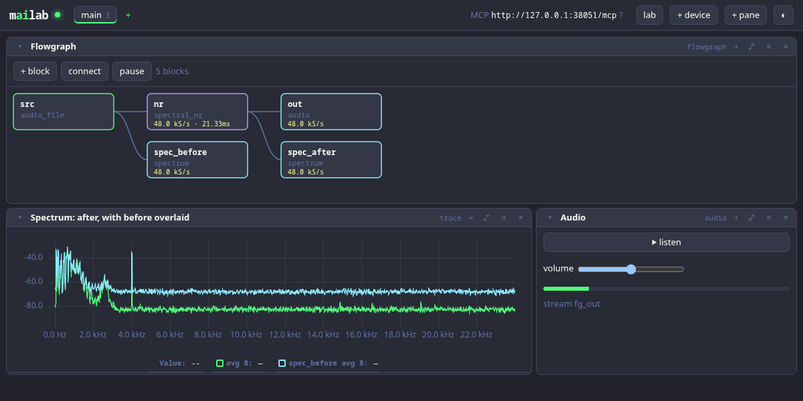

<!-- generated by bin/block-docs.js from the block catalog, about.md and example.json: edit those and run `yarn block-docs` -->

# `spectral_nr`

**dsp** · Audio processing · [all blocks](../README.md)

> spectral noise reduction (STFT, sqrt-Hann 50%): wiener (decision-directed) or subtract; noise profile auto (minimum statistics), learn (set noise=learn during a noise-only segment, then hold) or learn_s at start

Classic spectral noise reduction on an STFT (sqrt-Hann, 50 % overlap): Wiener filtering with a
decision-directed SNR estimate, or spectral subtraction. The noise profile is tracked automatically (minimum
statistics), learned on demand (`noise: learn` during a noise-only stretch, then `hold`), or learned from the first
`learn_s` seconds. `floor_db` caps the attenuation so the result doesn't sound watery. CPU-only, a few ms of latency;
for stronger, speech-aware reduction use `denoise`.

The example plays a generated test recording (`$MEDIA/demo.wav`: a buzzy voice-like signal with 50 Hz hum, a 4 kHz whistle, hiss and clicks); with a microphone, swap `src` for `audio_in` {stream: "browser_mic"}.

## Parameters

| name | default | description |
|---|---|---|
| `bypass` | `false` | pass the input through (same delay; live A/B) |
| `method` | `"wiener"` | wiener\|subtract |
| `strength` | `1` | over-subtraction |
| `floor_db` | `15` | max attenuation dB |
| `noise` | `"auto"` | auto\|learn\|hold |
| `learn_s` | `0` | learn the first seconds, then hold (0 = use `noise`) |
| `frame_ms` | `20` | STFT frame (rounded to 2^n samples); latency = half of it |
| `window_s` | `1.5` | minimum-statistics window |
| `smoothing` | `0.98` | decision-directed a priori SNR |

## Inputs and outputs

- **Input:** real audio (complex: real part)
- **Output:** real audio, same rate

## Example

Wiener noise reduction on the test recording: the hiss floor between the harmonics drops.



`$MEDIA` is your media directory (`DATA_DIR/media` or one of `MAILAB_MEDIA_DIRS`); the screenshot and tests use generated files (`demo.wav`: see `makeMedia` in `src/utils/block-docs`).

Ask the AI:

> Reduce the hiss on the recording and show me the spectrum before and after.

Graph ([example.json](example.json)):

```json
{
  "blocks": [
    {"id": "src", "type": "audio_file", "params": {"path": "$MEDIA/demo.wav", "rate": 48000}},
    {"id": "nr", "type": "spectral_nr", "params": {"method": "wiener", "floor_db": 15}},
    {"id": "out", "type": "audio", "params": {"rate": 48000}},
    {"id": "spec_before", "type": "spectrum", "params": {"fft": 4096, "traces": ["avg"], "average": 8, "fps": 4}},
    {"id": "spec_after", "type": "spectrum", "params": {"fft": 4096, "traces": ["avg"], "average": 8, "fps": 4, "overlay": ["spec_before"]}}
  ],
  "links": [["src", "nr"], ["nr", "out"], ["src", "spec_before"], ["nr", "spec_after"]]
}
```

MCP calls:

```
device_add {"id": "fg", "driver": "flowgraph"}
device_command {"id": "fg", "command": "set_graph", "args": {"graph": <the graph above>}}
pane_add {"type": "flowgraph", "title": "Flowgraph", "config": {"device": "fg"}}
pane_add {"type": "trace", "title": "Spectrum: after, with before overlaid", "config": {"traces": ["fg_spec_after"]}}
pane_add {"type": "audio", "title": "Audio", "config": {"stream": "fg_out"}}
```

## Related

- [`denoise`](../denoise/README.md): neural speech denoise (DeepFilterNet, RNNoise)
- [`gate`](../gate/README.md): noise gate / downward expander
- [`hum_notch`](../hum_notch/README.md): 50/60 Hz mains hum and harmonics remover
