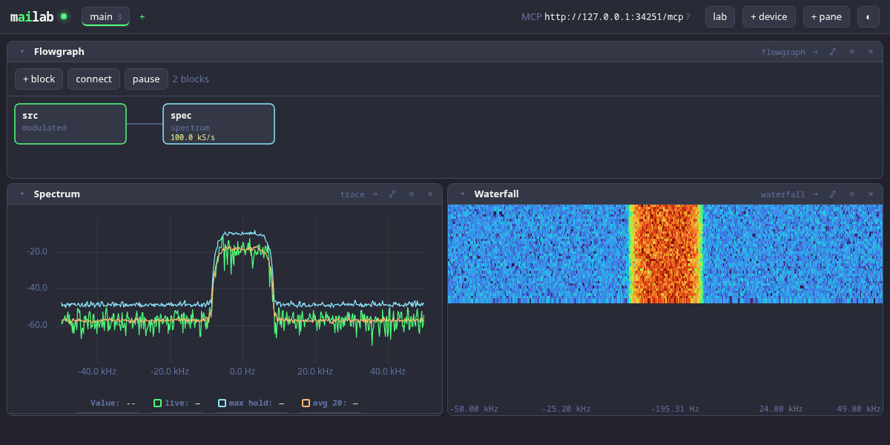

<!-- generated by bin/block-docs.js from the block catalog, about.md and example.json: edit those and run `yarn block-docs` -->

# `spectrum`

**sink** · Sinks and views · [all blocks](../README.md)

> spectrum analyzer -&gt; trace &lt;device&gt;_&lt;id&gt; (dBFS): RBW or FFT size, window, traces live / max / min / avg (power average over `average` frames), display points with peak/sample detector

Spectrum analyzer: set a resolution bandwidth `rbw` (FFT size follows from the rate and window) or an `fft` size,
a `window` (hann, blackmanharris for dynamic range, flattop for amplitude accuracy), and which `traces` to draw: live,
max hold, min hold, power average over `average` frames. `points` reduces the display with a peak or sample detector.
Real input shows positive frequencies only, `center` shifts the axis to RF. Put two spectrum blocks before and after a
chain and `overlay` one on the other for before/after in one plot. In the trace pane: markers, peak search, and a
waterfall pane on the same trace.

## Parameters

| name | default | description |
|---|---|---|
| `rbw` | `0` | resolution bandwidth Hz (0 = use fft) |
| `fft` | `1024` | FFT size when rbw is 0 |
| `window` | `"hann"` | hann\|blackmanharris\|flattop\|rect |
| `traces` | `["live"]` | any of live, max, min, avg |
| `average` | `8` | frames in the avg trace (exponential, power domain) |
| `points` | `0` | display points (0 = all bins) |
| `detector` | `"peak"` | peak\|sample when reducing to points |
| `fps` | `10` | trace updates per second |
| `center` | `0` | Hz added to x axis |
| `onesided` | `"auto"` | auto (real input: positive frequencies only) \| true \| false |
| `overlay` | `[]` | ids of other spectrum blocks drawn here too (before/after: put one before and one after a chain) |

## Inputs and outputs

- **Input:** complex IQ or real
- **Output:** trace &lt;device&gt;_&lt;id&gt; (Hz vs dBFS, one series per `traces` entry)

## Example

A QPSK signal with a 200 Hz RBW, Blackman-Harris window: live, max hold and average traces, a peak marker, and a waterfall.



Ask the AI:

> Show me the spectrum with 200 Hz RBW, max hold and averaging, and a waterfall.

Graph ([example.json](example.json)):

```json
{
  "blocks": [
    {"id": "src", "type": "modulated", "params": {"scheme": "qpsk", "rate": 100000, "sps": 8, "snr_db": 30}},
    {"id": "spec", "type": "spectrum", "params": {"rbw": 200, "window": "blackmanharris", "traces": ["live", "max", "avg"], "average": 20, "points": 512}}
  ],
  "links": [["src", "spec"]]
}
```

MCP calls:

```
device_add {"id": "fg", "driver": "flowgraph"}
device_command {"id": "fg", "command": "set_graph", "args": {"graph": <the graph above>}}
pane_add {"type": "flowgraph", "title": "Flowgraph", "config": {"device": "fg"}}
pane_add {"type": "trace", "title": "Spectrum", "config": {"traces": ["fg_spec"]}}
pane_add {"type": "waterfall", "title": "Waterfall", "config": {"trace": "fg_spec", "rows": 80}}
```

## Related

- [`scope`](../scope/README.md): triggered oscilloscope with measurements
- [`constellation`](../constellation/README.md): I/Q scatter of symbols
- [`measure`](../measure/README.md): one statistic of the stream as a channel
- [`signal`](../signal/README.md): complex tone plus noise, the basic test signal
