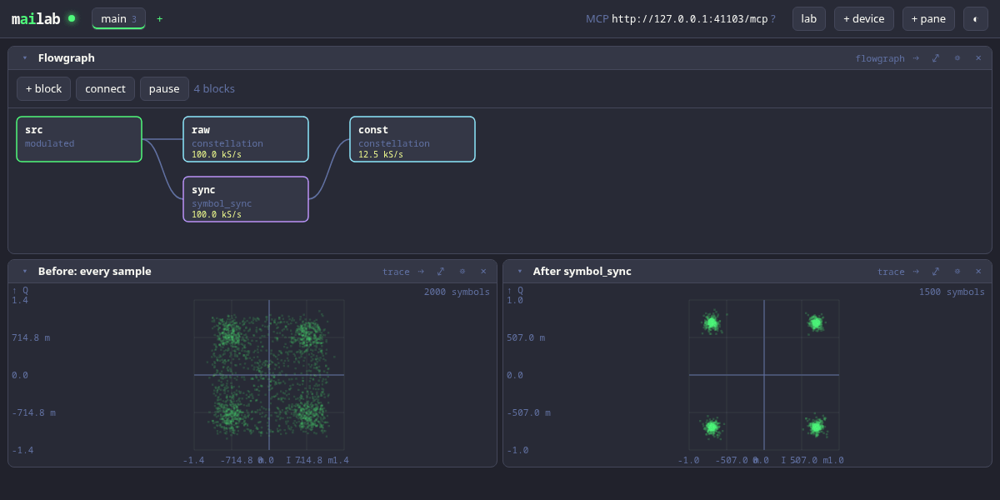

<!-- generated by bin/block-docs.js from the block catalog, about.md and example.json: edit those and run `yarn block-docs` -->

# `symbol_sync`

**dsp** · Modulation, demodulation and sync · [all blocks](../README.md)

> RRC symbol timing recovery, one sample per symbol out. method liquid (polyphase, best for QAM64+) or gardner (matched filter + Gardner; use it for rectangular qam32, where the liquid loop mis-locks)

Symbol timing recovery for RRC-shaped linear modulations: a polyphase matched filter bank and timing loop
(liquid symsync) take samples at `sps` per symbol and output one sample per symbol at the optimum instant. `method`
gardner (matched filter + Gardner detector) is better for rectangular qam32, where the liquid loop can mis-lock; for
QAM64 and up lower `bandwidth` to 0.001-0.003. Follow with `carrier_recovery` if there is a frequency offset, then
`slicer` or `demod`.

## Parameters

| name | default | description |
|---|---|---|
| `sps` | `8` | samples per symbol |
| `beta` | `0.35` | RRC roll-off (same as the transmitter) |
| `bandwidth` | `0.02` | loop bandwidth (high-order QAM: 0.001-0.003) |
| `method` | `"liquid"` | liquid \| gardner |

## Inputs and outputs

- **Input:** complex IQ at `sps` samples per symbol (RRC-shaped)
- **Output:** complex symbols, one per symbol (rate / sps)

## Example

QPSK at 22 dB SNR: the raw samples (8 per symbol, pulse-shape trajectories) and the one-sample-per-symbol output.



Ask the AI:

> Recover symbol timing on the QPSK signal and show the constellation before and after.

Graph ([example.json](example.json)):

```json
{
  "blocks": [
    {"id": "src", "type": "modulated", "params": {"scheme": "qpsk", "sps": 8, "snr_db": 22}},
    {"id": "raw", "type": "constellation", "params": {"points": 2000}},
    {"id": "sync", "type": "symbol_sync", "params": {"sps": 8, "beta": 0.35}},
    {"id": "const", "type": "constellation", "params": {"points": 1500}}
  ],
  "links": [["src", "raw"], ["src", "sync"], ["sync", "const"]]
}
```

MCP calls:

```
device_add {"id": "fg", "driver": "flowgraph"}
device_command {"id": "fg", "command": "set_graph", "args": {"graph": <the graph above>}}
pane_add {"type": "flowgraph", "title": "Flowgraph", "config": {"device": "fg"}}
pane_add {"type": "trace", "title": "Before: every sample", "config": {"traces": ["fg_raw"]}}
pane_add {"type": "trace", "title": "After symbol_sync", "config": {"traces": ["fg_const"]}}
```

## Related

- [`matched_filter`](../matched_filter/README.md): RRC receive filter matching the transmitter
- [`carrier_recovery`](../carrier_recovery/README.md): decision-directed PLL removing carrier offset and phase
- [`slicer`](../slicer/README.md): symbols to bits (linear schemes or 2/4-level real), with EVM
- [`constellation`](../constellation/README.md): I/Q scatter of symbols
