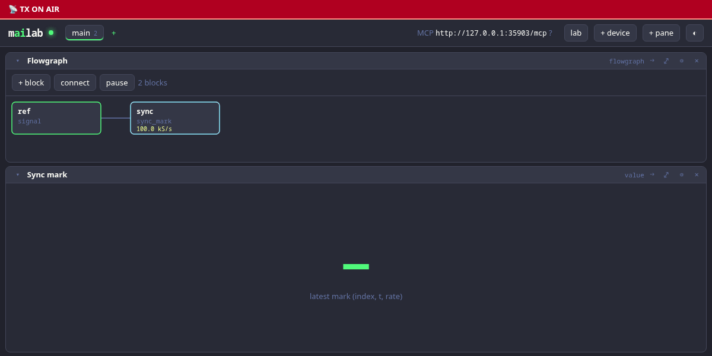

<!-- generated by bin/block-docs.js from the block catalog, about.md and example.json: edit those and run `yarn block-docs` -->

# `sync_mark`

**sink** · Digital: bits, framing, BER, UART, protocol decode · [all blocks](../README.md)

> stamp sync pulses (level crossings) with global sample index + host time so separate instruments align to one timebase (read the marks with the timebase_align tool); value &lt;device&gt;_&lt;id&gt;_mark, count channel

`sync_mark` watches a stream for level crossings — a sync pulse every instrument sees (a GPIO toggle, a
pulse injected into a scope channel and a flowgraph source at once) — and stamps each one as a mark:
`value <device>_<id>_mark` = `{index, t, rate}`, the global sample index of the edge, the estimated host
time of the edge, and the sample rate. Feed the marks of two instruments to the `timebase_align` MCP tool
to get the sample-grid offset between them (stated tolerance: one flowgraph tick, typically much better
since tick quantisation is common-mode when both edges land in the same tick). The math lives in
`src/utils/timebase` (`offsetSeconds`, `alignIndex`, `driftPpm`).

Real part is used for complex samples. `min_gap_s` throttles re-triggers (set it well below your pulse
period; a pulse train stamps every pulse).

## Parameters

| name | default | description |
|---|---|---|
| `level` | `0.5` | trigger level (real part is used for complex samples) |
| `edge` | `"rising"` | edge direction: rising or falling |
| `min_gap_s` | `0.05` | minimum seconds between stamped pulses |

## Inputs and outputs

- **Input:** real or complex samples
- **Output:** value &lt;device&gt;_&lt;id&gt;_mark ({index, t, rate}), channel &lt;device&gt;_&lt;id&gt;_count

## Example

A 10 kHz reference tone stands in for a sync pulse train: sync_mark stamps every rising zero-crossing with its sample index and host time, shown as a JSON value.



Ask the AI:

> Stamp sync pulses for timebase alignment.

Graph ([example.json](example.json)):

```json
{
  "blocks": [
    {"id": "ref", "type": "signal", "params": {"rate": 100000, "freq": 10000, "amp": 1, "noise": 0.001}},
    {"id": "sync", "type": "sync_mark", "params": {"level": 0, "edge": "rising", "min_gap_s": 0.00005}}
  ],
  "links": [["ref", "sync"]]
}
```

MCP calls:

```
device_add {"id": "fg", "driver": "flowgraph"}
device_command {"id": "fg", "command": "set_graph", "args": {"graph": <the graph above>}}
pane_add {"type": "flowgraph", "title": "Flowgraph", "config": {"device": "fg"}}
pane_add {"type": "value", "title": "Sync mark", "config": {"channel": "fg_sync_mark", "label": "latest mark (index, t, rate)"}}
```

## Related

- [`scope`](../scope/README.md): triggered oscilloscope with measurements
- [`measure`](../measure/README.md): one statistic of the stream as a channel
- [`baud_est`](../baud_est/README.md): estimate the symbol rate of an FSK/OOK stream from its zero crossings
