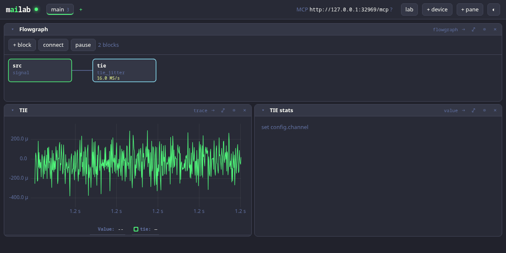

<!-- generated by bin/block-docs.js from the block catalog, about.md and example.json: edit those and run `yarn block-docs` -->

# `tie_jitter`

**sink** · Filters and DSP · [all blocks](../README.md)

> time error of threshold crossings against an ideal UI grid (TIE) -&gt; trace &lt;device&gt;_&lt;id&gt; (x = edge time s, y = TIE UI), channels &lt;device&gt;_&lt;id&gt;_rms / _pp (UI), value summary. libscopehal-style jitter measurement on synthetic or live line codes.

`tie_jitter` measures the time error of the waveform's threshold crossings
against an ideal grid of unit intervals at `bitrate` — the classic TIE
(time error) trace used for jitter analysis (libscopehal's TIE decoder is
the reference concept). Crossing times are interpolated, so sub-sample
resolution is kept. Output: trace `<device>_<id>` (TIE in UI vs edge time),
channels `<device>_<id>_rms` and `<device>_<id>_pp` (UI), plus a value
summary. Feed it a clock or a line code where you know the line rate; pair
with `cdr` when the rate itself drifts.

## Parameters

| name | default | description |
|---|---|---|
| `bitrate` | `1000000` | line rate Hz (UI rate) |
| `keep` | `1000` | TIE points kept |
| `fps` | `5` | updates/s |

## Inputs and outputs

- **Input:** real waveform carrying a clock or line code at `bitrate`
- **Output:** trace &lt;device&gt;_&lt;id&gt; (TIE vs edge time, UI), channels &lt;device&gt;_&lt;id&gt;_rms / _pp, value &lt;device&gt;_&lt;id&gt;

## Example

TIE of a jittery clock: a 1 MHz sine clock with 0.1 UI of Gaussian edge jitter, measured against the ideal 1 UI grid.



Ask the AI:

> Measure the TIE of this clock against the ideal grid and show the jitter statistics.

Graph ([example.json](example.json)):

```json
{
  "blocks": [
    {"id": "src", "type": "signal", "params": {"rate": 16000000, "freq": 1000000, "amp": 1, "noise": 0.001}},
    {"id": "tie", "type": "tie_jitter", "params": {"bitrate": 1000000, "keep": 500}}
  ],
  "links": [["src", "tie"]]
}
```

MCP calls:

```
device_add {"id": "fg", "driver": "flowgraph"}
device_command {"id": "fg", "command": "set_graph", "args": {"graph": <the graph above>}}
pane_add {"type": "flowgraph", "title": "Flowgraph", "config": {"device": "fg"}}
pane_add {"type": "trace", "title": "TIE", "config": {"traces": ["fg_tie"]}}
pane_add {"type": "value", "title": "TIE stats", "config": {"values": ["fg_tie"]}}
```

## Related

- [`cdr`](../cdr/README.md): clock/data recovery (CDR) with a second-order PLL
- [`eye_mask`](../eye_mask/README.md): eye diagram with a keep-out mask and hit statistics
- [`eye`](../eye/README.md): eye diagram
- [`baud_est`](../baud_est/README.md): estimate the symbol rate of an FSK/OOK stream from its zero crossings
- [`measure`](../measure/README.md): one statistic of the stream as a channel
