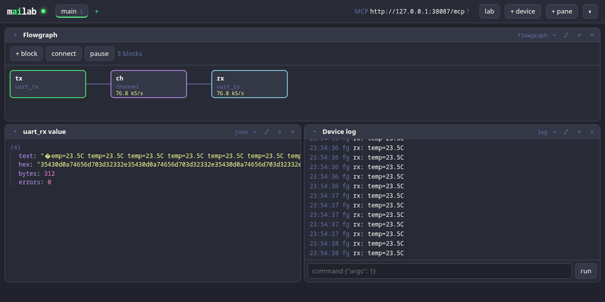

<!-- generated by bin/block-docs.js from the block catalog, about.md and example.json: edit those and run `yarn block-docs` -->

# `uart_rx`

**sink** · Digital: bits, framing, BER, UART, protocol decode · [all blocks](../README.md)

> UART receiver on line levels (logic or analog, any oversampling) or bits: bytes -&gt; value &lt;device&gt;_&lt;id&gt; (text + hex), blob, and each text line into the device log (for classifiers/notifications); error count channel

UART receiver on line levels (a logic capture, an analog trace, any oversampling: the rate divided by `baud`) or
on a bit stream: decoded bytes go to a value (text + hex), a blob, and each text line into the device log, where
classifiers and notifications can react to it; framing errors are counted. Set `invert` for idle-low lines (RS-232
levels). For other protocols, or sigrok's UART decoder with all its options, use `decode`.

## Parameters

| name | default | description |
|---|---|---|
| `baud` | `9600` | bit rate (oversampling = input rate / baud) |
| `bits` | `8` | data bits |
| `parity` | `"none"` | none\|even\|odd |
| `stop` | `1` | stop bits |
| `invert` | `false` | inverted line (idle low, e.g. RS-232 levels) |

## Inputs and outputs

- **Input:** real line levels (any oversampling) or bits
- **Output:** value &lt;device&gt;_&lt;id&gt; (text, hex, bytes, errors), blob &lt;device&gt;_&lt;id&gt;, device log line per text line, channel &lt;device&gt;_&lt;id&gt;_errors

## Example

A 9600 baud UART line with noise: the decoded text (value) and the lines it logged.



Ask the AI:

> Decode the UART on this line at 9600 baud and show me the text.

Graph ([example.json](example.json)):

```json
{
  "blocks": [
    {"id": "tx", "type": "uart_tx", "params": {"text": "temp=23.5C\r\n", "baud": 9600, "sps": 8, "repeat_ms": 200}},
    {"id": "ch", "type": "channel", "params": {"snr_db": 20}},
    {"id": "rx", "type": "uart_rx", "params": {"baud": 9600, "bits": 8, "parity": "none"}}
  ],
  "links": [["tx", "ch"], ["ch", "rx"]]
}
```

MCP calls:

```
device_add {"id": "fg", "driver": "flowgraph"}
device_command {"id": "fg", "command": "set_graph", "args": {"graph": <the graph above>}}
pane_add {"type": "flowgraph", "title": "Flowgraph", "config": {"device": "fg"}}
pane_add {"type": "json", "title": "uart_rx value", "config": {"value": "fg_rx"}}
pane_add {"type": "log", "title": "Device log", "config": {"device": "fg"}}
```

## Related

- [`uart_tx`](../uart_tx/README.md): UART transmitter: text or hex to line levels
- [`decode`](../decode/README.md): sigrok / builtin protocol decoder on logic samples (UART, SPI, I2C...)
- [`slicer`](../slicer/README.md): symbols to bits (linear schemes or 2/4-level real), with EVM
