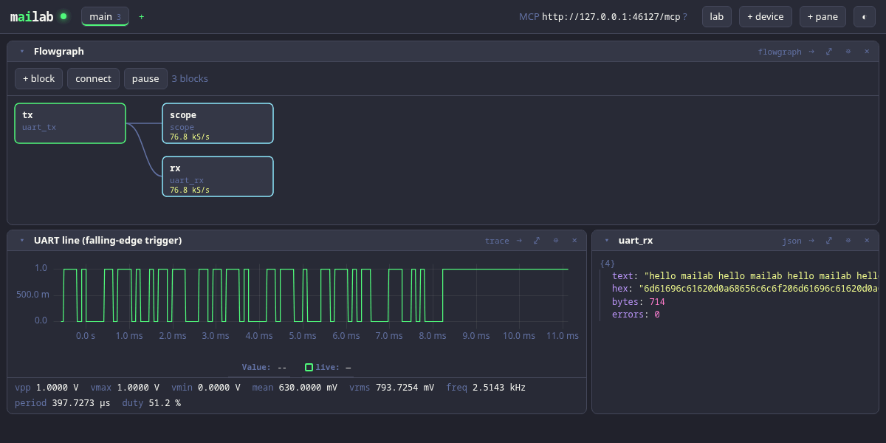

<!-- generated by bin/block-docs.js from the block catalog, about.md and example.json: edit those and run `yarn block-docs` -->

# `uart_tx`

**source** · Digital: bits, framing, BER, UART, protocol decode · [all blocks](../README.md)

> UART transmitter: text/hex -&gt; line levels (idle high) at baud * sps; repeats every repeat_ms

UART transmitter: `text` (escape sequences like `\r\n` work) or `hex` bytes framed with start bit, `bits` data
bits, optional parity and `stop` bits, as line levels (1 = idle) at `baud` x `sps` samples per second, repeated every
`repeat_ms`. Use it to test `uart_rx` and `decode`, to generate a reference waveform, or with `sps` 1 as a bit stream
into `mod` for an over-the-air serial link.

## Parameters

| name | default | description |
|---|---|---|
| `text` | `"hello mailab\r\n"` | text to send (or use hex) |
| `hex` | `""` | bytes as hex |
| `baud` | `9600` | bit rate |
| `bits` | `8` | data bits |
| `parity` | `"none"` | none\|even\|odd |
| `stop` | `1` | stop bits |
| `sps` | `8` | samples per bit (1 = bit stream) |
| `repeat_ms` | `500` | 0 = send once |

## Inputs and outputs

- **Input:** none (source)
- **Output:** real line levels (1 = idle/mark) at baud * sps

## Example

"hello mailab" at 9600 baud, 8 samples per bit: one frame on a triggered scope, and the bytes decoded back by uart_rx.



Ask the AI:

> Send "hello mailab" as 9600 8N1 UART and show me the waveform.

Graph ([example.json](example.json)):

```json
{
  "blocks": [
    {"id": "tx", "type": "uart_tx", "params": {"text": "hello mailab\r\n", "baud": 9600, "sps": 8, "repeat_ms": 100}},
    {"id": "scope", "type": "scope", "params": {"samples": 900, "trigger": "falling", "level": 0.5, "pretrigger": 0.05, "mode": "normal", "measure": []}},
    {"id": "rx", "type": "uart_rx", "params": {"baud": 9600}}
  ],
  "links": [["tx", "scope"], ["tx", "rx"]]
}
```

MCP calls:

```
device_add {"id": "fg", "driver": "flowgraph"}
device_command {"id": "fg", "command": "set_graph", "args": {"graph": <the graph above>}}
pane_add {"type": "flowgraph", "title": "Flowgraph", "config": {"device": "fg"}}
pane_add {"type": "trace", "title": "UART line (falling-edge trigger)", "config": {"traces": ["fg_scope"]}}
pane_add {"type": "json", "title": "uart_rx", "config": {"value": "fg_rx"}}
```

## Related

- [`uart_rx`](../uart_rx/README.md): UART receiver: line levels or bits to text
- [`decode`](../decode/README.md): sigrok / builtin protocol decoder on logic samples (UART, SPI, I2C...)
- [`scope`](../scope/README.md): triggered oscilloscope with measurements
