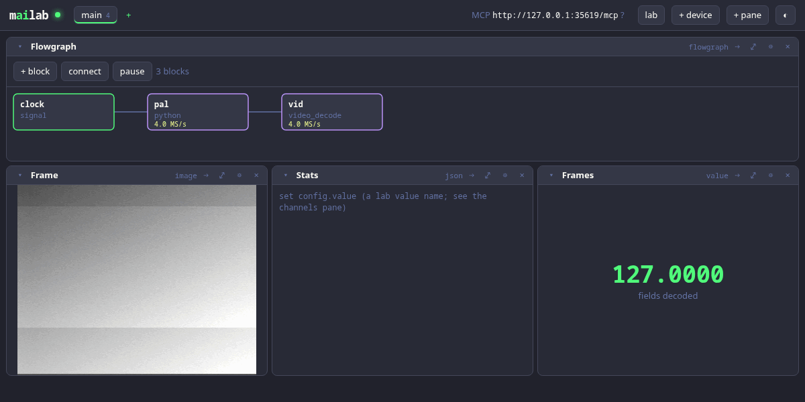

<!-- generated by bin/block-docs.js from the block catalog, about.md and example.json: edit those and run `yarn block-docs` -->

# `video_decode`

**dsp** · Filters and DSP · [all blocks](../README.md)

> decode analog composite video (PAL/NTSC) into grayscale image frames

Turns a raw composite video waveform into grayscale image frames. Feed it real
samples of a composite signal — directly, or the FM-discriminated output of an
analog FPV / ATV downlink (`fm_demod` → `video_decode`). Needs at least
2 MS/s of sample rate.

Sync detection is self-adaptive: the slicer threshold sits between the
sync-tip cluster (5th percentile of the waveform) and the blanking level
(12th percentile), both EMA-smoothed across buffers. That survives dark or
low-contrast fields, inverted polarity (`invert`), and a vsync tail flooding
the low end of the small rolling buffer. Short (<6.5 us) low runs are
horizontal syncs (the line period is tracked and low-passed); anything longer
than 20 us is a vertical sync and closes the current field.

Each line's active video is resampled into a `width`-pixel grayscale row; when
a vertical sync closes a field, the last ~576 (PAL) or ~480 (NTSC) rows are
packed into a PNG frame on the lab image stream `<device>_<id>`, suitable for
an image pane or the vision service. Every field also updates a stats value
(`<device>_<id>`: frame counter, detected line length, row count) and a frame
counter channel `<device>_<id>_frames`. Frames are published at most `fps`
times per second (stats still update every field).

A frame drops silently until at least half the expected active lines have been
assembled — give it a couple of field times before expecting pictures.

## Parameters

| name | default | description |
|---|---|---|
| `standard` | `"pal"` | pal or ntsc (line count / timing) |
| `invert` | `"false"` | invert video polarity (inverted video, some FM links) |
| `width` | `"720"` | frame width in pixels (rows are resampled to this) |
| `fps` | `"2"` | max published frames per second (stats still update every field) |
| `thresh` | `"0.5"` | sync slicing point, fraction of the way from the sync-tip level (5th pct) to the blanking level (12th pct); keep well below blanking |

## Inputs and outputs

- **Input:** real composite video (~1 Vpp; e.g. an FM-discriminated FPV downlink) at &gt;= 2 MS/s
- **Output:** grayscale frames on the image stream (&lt;device&gt;_&lt;id&gt;) + stats value + frame counter

## Example

A python block synthesizes a monochrome PAL test pattern (625-line interlace timing, sync tips at 0, blanking at 0.3, a vertical-brightness gradient with a horizontal ramp); video_decode slices the syncs, assembles 576 rows per field and publishes grayscale PNG frames plus stats.



Ask the AI:

> Decode a composite PAL video signal into image frames.

Graph ([example.json](example.json)):

```json
{
  "blocks": [
    {"id": "clock", "type": "signal", "params": {"rate": 4000000, "freq": 1000, "amp": 0.01, "noise": 0}},
    {"id": "pal", "type": "python", "params": {"code": "def work(x, rate):\n    rate = 4000000.0\n    n = len(x)\n    k0 = state.get('k', 0)\n    k = k0 + np.arange(n)\n    state['k'] = k0 + n\n    line = 256                    # 64 us line at 4 MS/s (PAL)\n    pos = k % line\n    ln = (k // line) % 625\n    act = (ln >= 45) & (ln < 621)\n    ramp = np.clip((pos - 40) / 200.0, 0, 1)\n    bright = ((ln - 45) % 576) / 575.0\n    level = 0.3 + 0.7 * np.clip(0.65 * bright + 0.35 * ramp, 0, 1)\n    y = np.where(act, level, 0.3)\n    y = np.where(pos < 20, 0.0, y)                 # hsync, 5 us\n    y = np.where((ln == 0) & (pos < 100), 0.0, y)  # vsync, 25 us\n    y += 0.01 * np.random.randn(n)\n    return y.astype(np.float64), rate"}},
    {"id": "vid", "type": "video_decode", "params": {"standard": "pal", "width": "720", "fps": "2"}}
  ],
  "links": [["clock", "pal"], ["pal", "vid"]]
}
```

MCP calls:

```
device_add {"id": "fg", "driver": "flowgraph"}
device_command {"id": "fg", "command": "set_graph", "args": {"graph": <the graph above>}}
pane_add {"type": "flowgraph", "title": "Flowgraph", "config": {"device": "fg"}}
pane_add {"type": "image", "title": "Frame", "config": {"image": "fg_vid"}}
pane_add {"type": "json", "title": "Stats", "config": {"channel": "fg_vid"}}
pane_add {"type": "value", "title": "Frames", "config": {"channel": "fg_vid_frames", "label": "fields decoded"}}
```

## Related

- [`fm_demod`](../fm_demod/README.md): FM demodulator to audio
- [`decimate`](../decimate/README.md): keeps every n-th sample (no filtering)
- [`spectrum`](../spectrum/README.md): spectrum analyzer trace: RBW, window, max/min hold, averaging
- [`scope`](../scope/README.md): triggered oscilloscope with measurements
