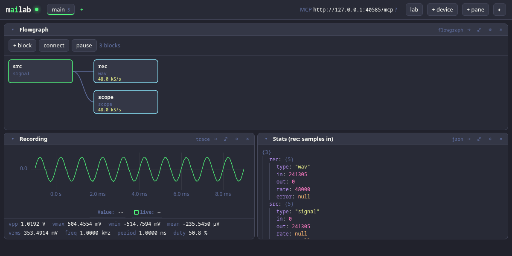

<!-- generated by bin/block-docs.js from the block catalog, about.md and example.json: edit those and run `yarn block-docs` -->

# `wav`

**sink** · Sinks and views · [all blocks](../README.md)

> record real samples to a WAV file

Records real samples to a 16-bit mono WAV file at the input rate, in `DATA_DIR/media` (default name
`<block id>.wav`) or another path inside the media directories. The file is finalized when the graph changes or stops.
Use it to keep a demodulated transmission or a processed recording; read it back with `audio_file` or the media tools
(`media_probe`, `audio_to_pcm`).

## Parameters

| name | default | description |
|---|---|---|
| `path` | `""` | output file inside DATA_DIR/media or MAILAB_MEDIA_DIRS (default &lt;media&gt;/&lt;block id&gt;.wav) |

## Inputs and outputs

- **Input:** real audio (complex: real part)
- **Output:** WAV file (16-bit mono) in the media dir

## Example

A 1 kHz tone recorded to `DATA_DIR/media/rec.wav`: the waveform being recorded and the block stats (samples written).



Ask the AI:

> Record this signal to a WAV file in the media folder.

Graph ([example.json](example.json)):

```json
{
  "blocks": [
    {"id": "rec", "type": "wav", "params": {}},
    {"id": "src", "type": "signal", "params": {"rate": 48000, "freq": 1000, "amp": 0.5, "noise": 0.01}},
    {"id": "scope", "type": "scope", "params": {"samples": 480, "measure": ["freq"]}}
  ],
  "links": [["src", "rec"], ["src", "scope"]]
}
```

MCP calls:

```
device_add {"id": "fg", "driver": "flowgraph"}
device_command {"id": "fg", "command": "set_graph", "args": {"graph": <the graph above>}}
pane_add {"type": "flowgraph", "title": "Flowgraph", "config": {"device": "fg"}}
pane_add {"type": "trace", "title": "Recording", "config": {"traces": ["fg_scope"]}}
pane_add {"type": "json", "title": "Stats (rec: samples in)", "config": {"value": "fg_stats"}}
```

## Related

- [`audio_file`](../audio_file/README.md): plays an audio file (WAV/FLAC/MP3/..., via ffmpeg) as real samples
- [`audio`](../audio/README.md): plays audio in the browser (lab audio stream)
- [`level_trigger`](../level_trigger/README.md): power squelch: catches bursts above a level (blob, trace, log)
